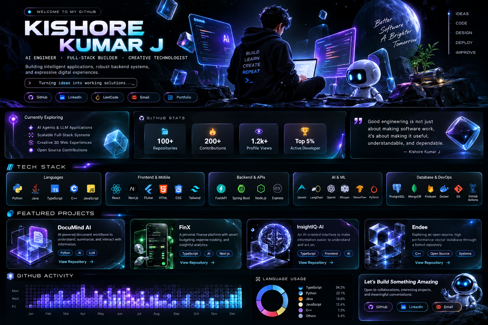

 <div align="center">



<br/>


<br/><br/>

<a href="https://github.com/kishoreX11"></a>
<a href="https://www.linkedin.com/in/kishore-kumar-j"></a>
<a href="https://leetcode.com/u/kishore1101"></a>
<a href="mailto:kishorejcs2006@gmail.com"></a>

<br/>


</div>

---

## `01 // THE DEVELOPER`

```text
NAME       Kishore Kumar J
ROLE       AI Engineer • Full-Stack Developer
FOCUS      AI Applications • Product Engineering
MINDSET    Learn → Build → Improve → Repeat
```

I'm a Computer Science and Business Systems student passionate about building practical software that combines intelligent features, reliable engineering, and thoughtful user experiences.

- Building full-stack applications and AI-powered tools.
- Exploring LLM integrations, APIs, and modern application architecture.
- Strengthening problem-solving and software development skills.
- Interested in open-source projects and meaningful collaboration.

> *I believe good software should be useful, understandable, and dependable.*

---

## `02 // TECHNOLOGY MATRIX`

<div align="center">

### LANGUAGES


### FRONTEND & MOBILE


### BACKEND & DATABASES


### AI & DEVELOPER TOOLS


</div>

**AI ecosystem:** Gemini API · LLM integrations · AI-powered application workflows

**Additional experience:** SQL · JWT authentication · REST APIs · TypeScript · PostgreSQL · UI/UX prototyping

---

## `03 // FEATURED BUILDS`

<div align="center">

<a href="https://github.com/kishoreX11/FinX">
  
</a>
<a href="https://github.com/kishoreX11/documind-ai">
  
</a>
<a href="https://github.com/kishoreX11/InsightIQ-AI">
  
</a>

</div>

### FinX — AI-Powered Personal Finance Advisor

A personal finance application concept focused on budgeting, expense tracking, and actionable financial insights.

`React` `TypeScript` `FastAPI` `PostgreSQL` `Gemini API`

[Explore my repositories →](https://github.com/kishoreX11?tab=repositories)

### DocuMind AI — Intelligent Document Workflows

An AI-assisted document experience designed to help users understand, summarize, and interact with information.

`AI` `LLMs` `Full-Stack Development`

[Explore my repositories →](https://github.com/kishoreX11?tab=repositories)

### InsightIQ-AI — Intelligent Insights

An AI-oriented interface concept focused on making information easier to explore and understand.

`TypeScript` `React` `AI`

[Explore my repositories →](https://github.com/kishoreX11?tab=repositories)

### Navault — Semantic Search

Exploring semantic search experiences for information-heavy environments, with an emphasis on structured data and usability.

`PostgreSQL` `Search` `Product UI/UX`

[Explore my repositories →](https://github.com/kishoreX11?tab=repositories)

---

## `04 // GITHUB TELEMETRY`

<div align="center">


<br/><br/>


<br/><br/>


</div>

---

## `05 // CURRENTLY EXPLORING`

<div align="center">

| Focus | Direction |
|:--|:--|
| `AI ENGINEERING` | LLM-powered applications and intelligent workflows |
| `FULL-STACK` | APIs, authentication, databases, and scalable applications |
| `PROBLEM SOLVING` | Data structures, algorithms, and coding practice |
| `CREATIVE TECH` | Motion design, interactive interfaces, and 3D web experiences |

</div>

---

## `06 // ENGINEERING PRINCIPLES`

<div align="center">

**01 — Understand the problem**

↓  

**02 — Design the system**

↓

**03 — Build the solution**

↓

**04 — Test, learn, and improve**

</div>

I value readable code, useful features, consistent learning, and user experiences that make complex tasks feel simple.

---

## `07 // CONNECT`

<div align="center">

### HAVE AN IDEA WORTH BUILDING?

I'm open to interesting projects, collaboration, and opportunities to learn from other developers.

<br/>

<a href="https://github.com/kishoreX11"></a>
<a href="https://www.linkedin.com/in/kishore-kumar-j"></a>
<a href="mailto:kishorejcs2006@gmail.com"></a>

<br/><br/>


<sub>BUILD WITH CURIOSITY · SHIP WITH PURPOSE · IMPROVE EVERY DAY</sub>

</div>
